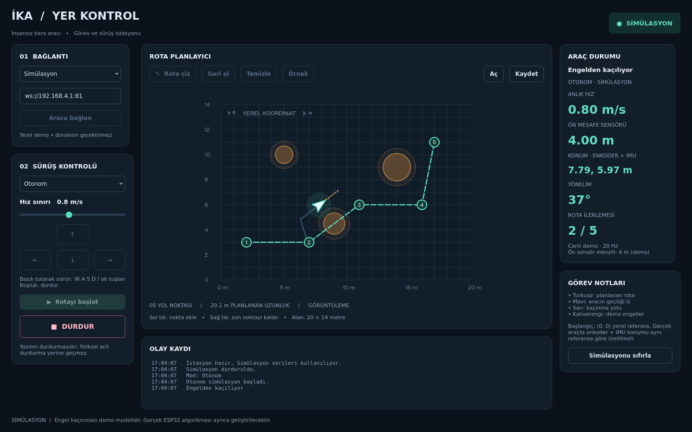

# İKA · Yer Kontrol İstasyonu

Windows için geliştirilen, Python/PySide6 tabanlı masaüstü prototipi. ESP32 ile Wi-Fi/WebSocket haberleşmesi ve enkoder + IMU tabanlı yerel konumlandırma hedeflenir.



## İlk sürümde çalışanlar

- 20 × 14 metrelik yerel alanda tıklayarak rota çizme, son noktayı geri alma, temizleme, JSON kaydetme/yükleme.
- Manuel sürüş: basılı tutulan ekran düğmeleri, WASD veya ok tuşları. Boşluk ile durdurma; pencere odağı kaybolunca manuel giriş bırakılır.
- Otonom simülasyon: rota takibi, örnek engellerin etrafından dolaşma ve rotaya dönüş. Geçiş bulunamazsa durur.
- Hız sınırı, anlık hız, ön mesafe, konum, yön, yol noktası ilerlemesi, olay kaydı ve iz çizgisi.
- Gerçek WebSocket bağlantısıyla şemaya uygun telemetri okuma, güncellik denetimi ve durdurma isteği gönderme.

**Sınırlar:** Gerçek araçta hareket/otonom başlatma henüz etkin değildir. ESP32 firmware'i bu depoda bulunmaz. Simülatör engel konumlarını önceden bilir; bu, tek mesafe sensörüyle çalışan gerçek engelden kaçınma algoritması değildir. Ön mesafe 4 m menzilli ideal ışın olarak modellenir. Kinematik, dönüşler ve hızlanma fiziksel araç doğruluğu taşımaz. Gerçek aracın çalıştığı veya durdurma isteğine uyduğu henüz doğrulanmadı.

## Windows'ta çalıştırma

1. Python **3.12 (64 bit)** kurun; Python Launcher (`py`) kurulu olsun.
2. Depoyu indirin/klonlayın.
3. `run_windows.bat` dosyasına çift tıklayın. İlk açılışta internet üzerinden Qt bağımlılıkları yüklenir.

PowerShell ile eşdeğeri:

```powershell
cd Bitirme_Projesi_IKA_arayuz
py -3.12 -m venv .venv
.\.venv\Scripts\python.exe -m pip install -r requirements.txt
.\.venv\Scripts\python.exe -m ika.app
```

Henüz bağımsız bir `.exe` paketi üretilmedi. Windows üzerinde çalışma ayrıca doğrulanacak; mevcut otomatik doğrulama Linux/Qt offscreen ortamında yapıldı.

## Kullanım

1. `Simülasyon` kaynağıyla başlayın. Araç (2, 3) m konumunda, +X yönüne bakar.
2. Mevcut örnek yolu deneyebilir veya `Temizle → Rota çiz` ile yeni noktalar ekleyebilirsiniz. Sol tık ekler, sağ tık son noktayı kaldırır. `Çizimi bitir` çizimden çıkarır.
3. `Otonom → Rotayı başlat` seçin. Planlanan yol turkuaz, geçilen iz mavi, kaçınma yolu sarıdır.
4. Görevi kesmek için `DURDUR` düğmesini kullanın. Yeniden başlatma rotanın ilk noktasından hedeflemeye başlar; kaldığı yerden devam özelliği değildir.
5. `Manuel` modda düğmeleri/tuşları basılı tutarak sürün. Hız sınırı 0.2–1.5 m/s arasında ayarlanır.
6. Gerçek telemetri için `ESP32 / Wi-Fi` kaynağını seçin, aracın WebSocket adresini yazıp bağlanın. Varsayılan IP/port yalnızca düzenlenebilir bir örnektir.

Yerel alanın kökeni sol alttadır; X sağa, Y yukarı, yön açısı +X'ten saat yönünün tersine radyan olarak ölçülür. Enkoder + IMU tahminindeki başlangıç referansı araç tarafında aynı olmalıdır. Enkoder/IMU sürüklenmesi için ileride kalibrasyon ve konum doğrulaması gerekecek.

## Geliştirme ve test

```bash
python3 -m venv .venv
.venv/bin/python -m pip install -r requirements.txt
.venv/bin/python -m ika.app
QT_QPA_PLATFORM=offscreen .venv/bin/python -m unittest discover -s tests -v
```

Windows'ta test: `.venv\Scripts\python.exe -m unittest discover -s tests -v`.

Testler: rota dosyası doğrulama, engellerle çarpışmadan rota tamamlama ve rotaya dönüş, durdurma, manuel çarpışma önleme, arayüzde rota çizme/başlatma/durdurma, tuş bırakma, yerel WebSocket sunucusuyla telemetri ve durdurma isteği, eski ve geçersiz veri.

## Entegrasyon

Mesajlar ve kalan araç tarafı gereksinimleri: [ESP32 protokolü](docs/ESP32_PROTOKOL.md). Tasarım kararları: [tasarım belgesi](docs/TASARIM.md).
